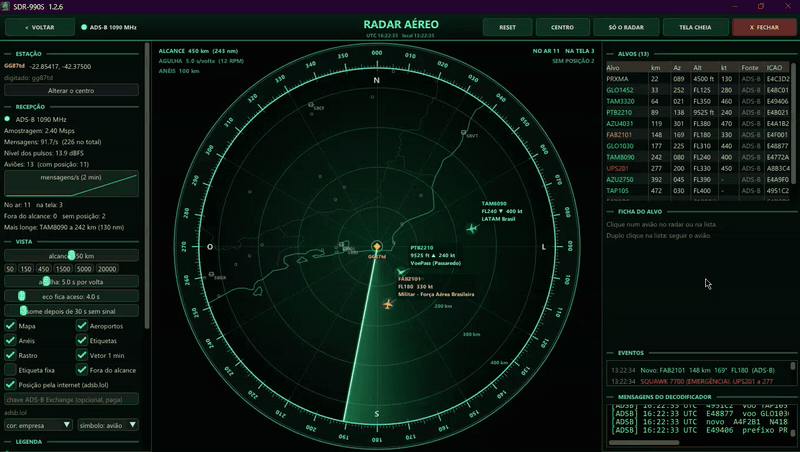

# SDR990S

Receptor SDR para Windows com a cara de um transceptor de HF de mesa: tela principal com S-meter de ponteiro, Band Scope e cachoeira, tela MAIN/SUB, dial grande, teclado de bandas, RIT/XIT, MULTI/CH e as colunas MAIN e SUB RECEIVER com os botões duplos. Embaixo do rádio fica a cachoeira grande com o IF DISPLAY.

## Radar Aéreo

Tela de radar em tela cheia, com a agulha girando 360°, que mostra os aviões que o dongle está ouvindo pelo **ADSB, ACARS, VDL2 e HFDL**. Mostra também as estações de terra do HFDL que transmitiram e a posição pela internet (adsb.lol) de quem foi ouvido sem posição. O alcance vai de 10 km até o planeta inteiro. *Clique na animação para ver o vídeo.*

## Download

Baixe o `.zip` em **[Releases](https://github.com/Rubenpereira/SDR990S/releases)**, descompacte onde quiser e rode o `SDR990S.exe`.

**Não precisa instalar.** A configuração fica no `SDR990S.ini`, ao lado do programa. Roda no Windows 7 SP1, 8, 10 e 11.

## O que tem

- **Aparelhos:** RTL-SDR (USB), RTL-TCP (rede) e SDRplay (com a [API oficial](https://www.sdrplay.com/api/)).
- **Modos:** LSB, USB, CW, AM, FM estreito e FM largo.
- **Cada botão faz a função do rádio.** Os de transmissão, que num receptor não servem, ganharam funções de recepção. Pare o mouse em cima de qualquer botão: a dica diz o que ele faz.
- **Filtros:** HI/LO-CUT, SHIFT/WIDTH do CW e filtros A/B/C por modo.
- **AGC:** SLOW, MID, FAST e OFF.
- **Redução de ruído e interferência:** NB1 e NB2, NR1 e NR2 (NR ESPECTRAL), NOTCH manual, BEF, A.NCH, BC, APF e PROC (compressor).
- **MAIN e SUB:** dois VFOs, com SPLIT, TF-SET, TRACKING, M>S e M/S.
- **Frequência:** teclado de bandas com memória por banda, ENT para digitar a frequência, GEN 1 (ondas curtas) e GEN 2 (VHF/UHF).
- **Memórias:** canais de memória e QUICK MEMO.
- **Gravação:** REC, STOP e PLAY.
- **Outros:** VOICE (fala a frequência), TIMER, XVTR (upconverter) e captura da tela (F12).
- **Decodificadores:** FT8 e FT4 (lista igual à do WSJT-X, com SNR, DT e frequência), CW, RTTY, SITOR-B/NAVTEX, DSC, ALE, PACTOR, PSK (BPSK31/63/125/250, QPSK31/63/125, BPSK63F e BPSK125F), DMR/P25/NXDN/dPMR/YSF/D-STAR, TETRA, HFDL, AIS, APRS, ACARS, VDL2, DRM, SSTV, WEFAX e analisador de sinal.

O guia completo dos botões está no [LEIA-ME.txt](LEIA-ME.txt).

## Compilar

Precisa do Visual Studio 2022 (ou Build Tools) com C++ e do CMake. Rode `COMPILAR.bat`: o programa sai em `pronto\SDR990S.exe`.

Os decodificadores externos (dsd-fme, AIS-catcher, direwolf etc.) não estão neste repositório. Eles vêm no `.zip` da release; veja o [TERCEIROS.txt](TERCEIROS.txt).

## Licença

Uso livre e **não comercial**, mantendo o crédito ao autor. Veja o [LICENSE.txt](LICENSE.txt). Os programas de terceiros seguem as licenças deles ([TERCEIROS.txt](TERCEIROS.txt)).

## Privacidade / Privacy

This program will not transfer any information to other networked systems unless specifically requested by the user or the person installing or operating it. It connects to the RTL-TCP server the user configures, and opens web links (for example aprs.fi or FlightAware) only when the user clicks them.

Online lookups are **off by default**. They run only after the user turns them on, and the choice is saved in `SDR990S.ini`:

- **"Look up registration and model on the web (hexdb.io)"** in the ADSB decoder sends the ICAO address or the registration of the aircraft heard to hexdb.io.
- **"Position from the internet (adsb.lol)"** on the Aerial Radar screen sends the ICAO address, registration or flight of the aircraft heard to adsb.lol, and also a position when completing an HFDL flight number. If the user enters their own ADS-B Exchange API key, the same lookups also go to ADS-B Exchange (RapidAPI).

The satellite tracker downloads public orbital elements (TLE) from Celestrak when the user opens it and the local file is missing or more than a day old, or when the user clicks "Update TLE". Nothing about the user is sent.

*Este programa não envia nenhuma informação para outros computadores, a não ser quando o próprio usuário pede. Ele se conecta ao servidor RTL-TCP que o usuário configurar e só abre links da internet quando o usuário clica neles.*

*As consultas pela internet vêm **desligadas**. Só funcionam depois que o usuário liga, e a escolha fica guardada no `SDR990S.ini`:*

- *"Buscar prefixo e modelo na internet (hexdb.io)", no decodificador ADSB, manda ao hexdb.io o código ICAO ou o prefixo dos aviões ouvidos.*
- *"Posição pela internet (adsb.lol)", na tela do Radar Aéreo, manda ao adsb.lol o código ICAO, o prefixo ou o voo dos aviões ouvidos, e uma posição quando completa o voo do HFDL. Com a chave do ADS-B Exchange do próprio usuário, as mesmas consultas vão também para o ADS-B Exchange (RapidAPI).*

*O rastreador de satélites baixa da Celestrak os elementos orbitais públicos (TLE) quando o usuário abre essa tela e o arquivo não existe ou tem mais de um dia, ou quando o usuário clica em "Atualizar TLE". Nada sobre o usuário é enviado.*

## Desinstalar / Uninstall

SDR990S is portable: it is not installed and changes nothing in Windows. To remove it, delete its folder.

*O SDR990S é portátil: não instala nada no Windows. Para remover, basta apagar a pasta dele.*
