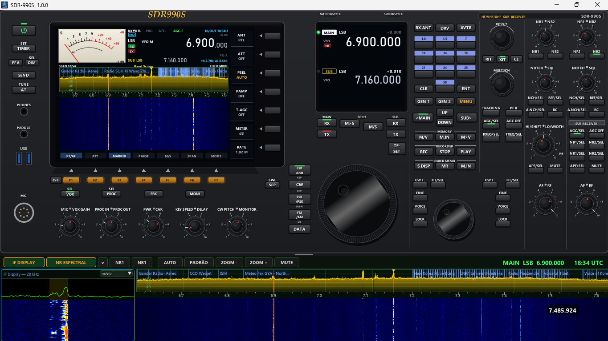

# SDR990S

Receptor SDR para Windows com a cara de um transceptor de HF de mesa: tela principal com S-meter de ponteiro, Band Scope e cachoeira, tela MAIN/SUB, dial grande, teclado de bandas, RIT/XIT, MULTI/CH e as colunas MAIN e SUB RECEIVER com os botões duplos. Embaixo do rádio fica a cachoeira grande com o IF DISPLAY.

## Download

Baixe o `.zip` em **[Releases](https://github.com/Rubenpereira/SDR990S/releases)**, descompacte onde quiser e rode o `SDR990S.exe`.

**Não precisa instalar.** A configuração fica no `SDR990S.ini`, ao lado do programa. Roda no Windows 7 SP1, 8, 10 e 11.

## O que tem

- **Aparelhos:** RTL-SDR (USB), RTL-TCP (rede) e SDRplay (com a [API oficial](https://www.sdrplay.com/api/)).
- **Modos:** LSB, USB, CW, AM, FM estreito e FM largo.
- **Cada botão faz a função do rádio.** Os de transmissão, que num receptor não servem, ganharam funções de recepção. Pare o mouse em cima de qualquer botão: a dica diz o que ele faz.
- **Filtros:** HI/LO-CUT, SHIFT/WIDTH do CW e filtros A/B/C por modo.
- **AGC:** SLOW, MID, FAST e OFF.
- **Redução de ruído e interferência:** NB1 e NB2, NR1 e NR2 (NR ESPECTRAL), NOTCH manual, BEF, A.NCH, BC, APF e PROC (compressor).
- **MAIN e SUB:** dois VFOs, com SPLIT, TF-SET, TRACKING, M>S e M/S.
- **Frequência:** teclado de bandas com memória por banda, ENT para digitar a frequência, GEN 1 (ondas curtas) e GEN 2 (VHF/UHF).
- **Memórias:** canais de memória e QUICK MEMO.
- **Gravação:** REC, STOP e PLAY.
- **Outros:** VOICE (fala a frequência), TIMER, XVTR (upconverter) e captura da tela (F12).
- **Decodificadores:** FT8 e FT4 (lista igual à do WSJT-X, com SNR, DT e frequência), CW, RTTY, SITOR-B/NAVTEX, DSC, ALE, PACTOR, DMR/P25/NXDN/dPMR/YSF/D-STAR, TETRA, HFDL, AIS, APRS, ACARS, VDL2, DRM, SSTV, WEFAX e analisador de sinal.

O guia completo dos botões está no [LEIA-ME.txt](LEIA-ME.txt).

## Compilar

Precisa do Visual Studio 2022 (ou Build Tools) com C++ e do CMake. Rode `COMPILAR.bat`: o programa sai em `pronto\SDR990S.exe`.

Os decodificadores externos (dsd-fme, AIS-catcher, direwolf etc.) não estão neste repositório. Eles vêm no `.zip` da release; veja o [TERCEIROS.txt](TERCEIROS.txt).

## Licença

Uso livre e **não comercial**, mantendo o crédito ao autor. Veja o [LICENSE.txt](LICENSE.txt). Os programas de terceiros seguem as licenças deles ([TERCEIROS.txt](TERCEIROS.txt)).
